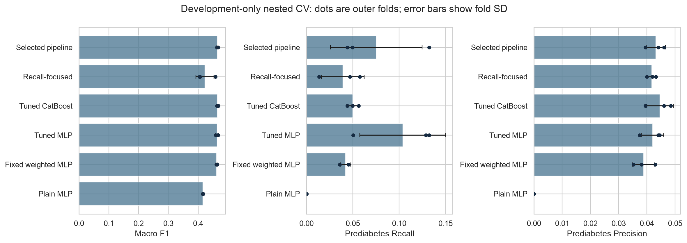
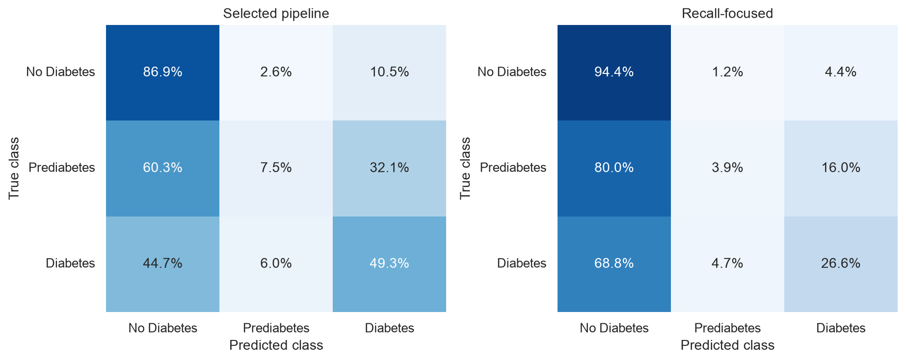
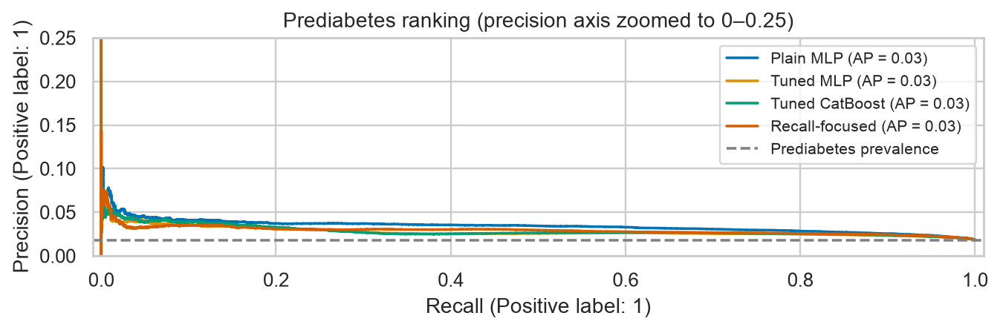
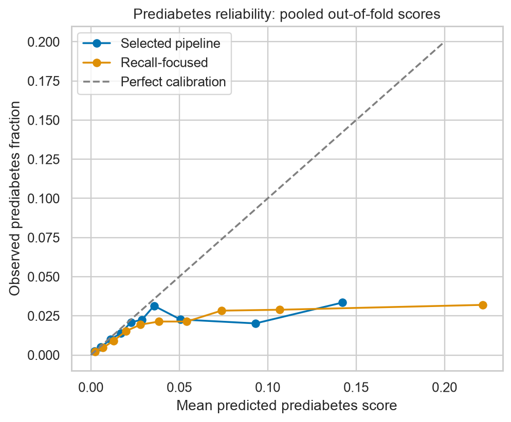

# Diabetes ML — development experiment v2

The new experiment evaluates tuning, sampling and calibration with **3 outer folds × 2 inner folds**, using only the original **228,312 development rows**. Historical test rows used: **0**. Original models, results and split IDs remain byte-for-byte unchanged.

The selected procedure obtained pooled out-of-fold macro F1 **0.4659**, compared with **0.4622** for the fixed weighted-MLP recipe re-fitted in the same outer folds. The recall-focused procedure obtained prediabetes recall **3.9%** at precision **4.1%**, with macro F1 **0.4307**. These are development-stage comparisons; they are not directly interchangeable with the original held-out test scores.

## Protocol and interpretation

- Outer folds evaluate the entire inner-search procedure. Each inner search compares 18 training configurations and six score/decision modes (108 candidates).
- Within each inner or outer training partition: 70% fit model/scaler/sampler; 10% choose training checkpoint; 10% fit a positive per-class log-probability scaling-and-bias calibrator; 10% tune decisions. All roles are disjoint from evaluation rows.
- Inner-validation mean macro F1 selects MLP, CatBoost and overall procedures independently. A separate procedure maximizes prediabetes recall subject to mean inner precision ≥5% and macro F1 ≥0.40. The 5% threshold and minimum 30 decision-set positive predictions are experimental safeguards, not clinical targets.
- Decision rules are tuned before outer evaluation. The precision requirement is **not guaranteed on new rows**; the focused procedure achieved ≥5% precision in **0 of 3 outer folds**. Infeasible searches explicitly fall back to the macro-F1 procedure.
- Training seeds 42, 43 and 44 assess stochastic variation in the chosen MLP with unchanged outer partitions. Seed results do not influence model selection.
- These methods were motivated by earlier exploration of this dataset. Nested CV estimates this predeclared development procedure; an independent external dataset is still needed for a new final generalization claim.

## Outer-fold results

| method | macro_f1 mean ± SD | prediabetes_recall mean ± SD | prediabetes_precision mean ± SD | prediabetes_ap mean ± SD |
| --- | --- | --- | --- | --- |
| fixed_plain_mlp | 0.4158 ± 0.0011 | 0.0000 ± 0.0000 | 0.0000 ± 0.0000 | 0.0345 ± 0.0009 |
| fixed_weighted_mlp | 0.4621 ± 0.0018 | 0.0422 ± 0.0054 | 0.0388 ± 0.0039 | 0.0324 ± 0.0013 |
| prediabetes_focused | 0.4226 ± 0.0304 | 0.0394 ± 0.0229 | 0.0417 ± 0.0016 | 0.0344 ± 0.0018 |
| selected_catboost | 0.4651 ± 0.0024 | 0.0499 ± 0.0061 | 0.0447 ± 0.0047 | 0.0359 ± 0.0013 |
| selected_mlp | 0.4633 ± 0.0041 | 0.1039 ± 0.0464 | 0.0420 ± 0.0040 | 0.0346 ± 0.0021 |
| selected_overall | 0.4648 ± 0.0019 | 0.0753 ± 0.0495 | 0.0432 ± 0.0034 | 0.0357 ± 0.0011 |

The ± values are standard deviations across three outer folds, not confidence intervals. Overlapping training folds and only three evaluations limit uncertainty claims.

The broader search should be judged against the fixed weighted recipe in these same folds. Its classification gains are modest. The recall-focused procedure does not provide a dependable improvement: its precision target can fail outside the decision and inner-validation portions, and its macro F1 is lower. Additional complexity alone has not resolved the rare-class problem.



### Pooled out-of-fold results

| method | accuracy | macro_f1 | balanced_accuracy | prediabetes_recall | prediabetes_precision | diabetes_recall | prediabetes_ap |
| --- | --- | --- | --- | --- | --- | --- | --- |
| fixed_plain_mlp | 0.8482 | 0.4158 | 0.4029 | 0.0000 | 0.0000 | 0.2418 | 0.0341 |
| fixed_weighted_mlp | 0.8090 | 0.4622 | 0.4717 | 0.0422 | 0.0382 | 0.4954 | 0.0320 |
| selected_mlp | 0.7855 | 0.4640 | 0.4876 | 0.1039 | 0.0411 | 0.5137 | 0.0277 |
| selected_catboost | 0.8146 | 0.4651 | 0.4706 | 0.0499 | 0.0444 | 0.4746 | 0.0286 |
| prediabetes_focused | 0.8328 | 0.4307 | 0.4163 | 0.0393 | 0.0413 | 0.2656 | 0.0292 |
| selected_overall | 0.8020 | 0.4659 | 0.4791 | 0.0753 | 0.0433 | 0.4930 | 0.0286 |

Each response is scored once by a pipeline that excluded its outer fold from fitting, calibration, decision tuning and hyperparameter selection. Different outer folds may choose different configurations. This evaluates a **selection procedure**, not one globally fitted model. The full fold-specific choices are saved in `fold*_frozen_choices.json`.

Pooled precision–recall curves combine scores from different fold-specific models, which may have different score scales. Use mean outer-fold average precision as the primary comparison of ranking quality; pooled curves are descriptive.





## Calibration

The custom calibrator fits five parameters to an independent calibration portion: three positive scales applied to log probabilities and two class biases (class-0 bias fixed to zero). Optimization minimizes multiclass log loss with mild parameter regularization. This is distinct from the existing decision offsets.

The following pairs evaluate the same fitted models on the same outer rows, before and after calibration. Means average the distinct outer-refitted configurations; this table is an ablation, not a selection criterion.

| mode | log_loss | brier | prediabetes_ap |
| --- | --- | --- | --- |
| calibrated_argmax | 0.3945 | 0.2212 | 0.0349 |
| raw_argmax | 0.4807 | 0.2656 | 0.0337 |

Lower log loss and multiclass Brier score indicate better probabilistic performance overall; neither alone isolates calibration from discrimination. Vector scaling may also change ranking. Reliability plots help inspect calibration, especially for the rare class.



## Sampling experiments

| name | macro_f1 | prediabetes_recall | prediabetes_precision | prediabetes_ap |
| --- | --- | --- | --- | --- |
| fixed_plain_mlp | 0.4608 | 0.0619 | 0.0447 | 0.0347 |
| fixed_weighted_mlp | 0.4591 | 0.0970 | 0.0386 | 0.0324 |
| mlp_balanced_sampling | 0.4521 | 0.0799 | 0.0363 | 0.0280 |
| mlp_random_oversampling | 0.4571 | 0.0529 | 0.0414 | 0.0327 |
| mlp_smotenc | 0.4568 | 0.0305 | 0.0338 | 0.0291 |

These are **inner-validation averages**, included to compare training strategies. They are not additional outer test estimates. Random oversampling and SMOTENC increase prediabetes training count to 15% of the no-diabetes count; they do not balance the evaluation distribution. Class-balanced replacement sampling draws equal expected class frequencies per epoch. Sampling variants use unweighted loss to avoid double correction.

The random-oversampling, SMOTENC and balanced-sampling configurations share their architecture, regularization and epoch budget. The fixed reference recipes have different regularization or epoch settings, so differences against those references cannot be attributed to sampling alone.

SMOTENC treats binary and ordinal survey answers as categorical; BMI and mental/physical unhealthy-day counts are numeric. Categorical codes are asserted valid after generation. Synthetic numeric combinations are still approximate survey profiles and are not new observed respondents. Scaling is fitted on the original fit rows; samplers never see calibration, decision or evaluation rows.

## Seed robustness

| fold | seed | name | mode | macro_f1 | prediabetes_recall | prediabetes_precision |
| --- | --- | --- | --- | --- | --- | --- |
| 0 | 42 | mlp_focal_g1 | calibrated_macro | 0.4587 | 0.1289 | 0.0374 |
| 0 | 43 | mlp_focal_g1 | calibrated_macro | 0.4623 | 0.0706 | 0.0447 |
| 0 | 44 | mlp_focal_g1 | calibrated_macro | 0.4607 | 0.0677 | 0.0404 |
| 1 | 42 | mlp_focal_g1 | raw_macro | 0.4650 | 0.0504 | 0.0446 |
| 1 | 43 | mlp_focal_g1 | raw_macro | 0.4617 | 0.1015 | 0.0346 |
| 1 | 44 | mlp_focal_g1 | raw_macro | 0.4629 | 0.0554 | 0.0367 |
| 2 | 42 | mlp_regularized_p075 | calibrated_macro | 0.4664 | 0.1324 | 0.0440 |
| 2 | 43 | mlp_regularized_p075 | calibrated_macro | 0.4633 | 0.0986 | 0.0383 |
| 2 | 44 | mlp_regularized_p075 | calibrated_macro | 0.4616 | 0.0266 | 0.0432 |

Only the training seed changes within each outer fold. Variation combines stochastic model fitting with recalibration and decision tuning on fixed row portions. No best seed is chosen from these outer scores.

## Profile and subgroup analysis

The development set contains **206,269 unique feature profiles**, including **1,554 profiles with more than one target label**. These cover **5,040 rows**, including **279 prediabetes rows. Coarse answers can match for distinct people, so conflicting labels are not automatically labeling mistakes. They indicate ambiguity in the available features.

A separate three-fold feature-profile-grouped sensitivity run uses the **fixed weighted-MLP recipe**, with no hyperparameter selection on grouped evaluation folds. No feature profile crosses a grouped training/evaluation boundary. Mean macro F1: **0.4639**; prediabetes recall **5.2%**; precision **4.4%**. This tests an unseen-profile setting; profiles are not verified person identities.

| subgroup | rows | prediabetes_support | prediabetes_prevalence | macro_f1 | prediabetes_recall | prediabetes_precision | prediabetes_ap |
| --- | --- | --- | --- | --- | --- | --- | --- |
| sex_0 | 127788 | 2336 | 0.0183 | 0.4696 | 0.0929 | 0.0447 | 0.0287 |
| sex_1 | 100524 | 1832 | 0.0182 | 0.4604 | 0.0529 | 0.0405 | 0.0289 |
| age_1_to_5 | 48979 | 406 | 0.0083 | 0.4171 | 0.1281 | 0.0456 | 0.0181 |
| age_6_to_9 | 99231 | 1789 | 0.0180 | 0.4692 | 0.0866 | 0.0465 | 0.0309 |
| age_10_to_13 | 80102 | 1973 | 0.0246 | 0.4447 | 0.0542 | 0.0385 | 0.0297 |
| income_1_to_3 | 33915 | 977 | 0.0288 | 0.4493 | 0.1269 | 0.0411 | 0.0355 |
| income_4_to_6 | 74165 | 1619 | 0.0218 | 0.4594 | 0.0896 | 0.0464 | 0.0316 |
| income_7_to_8 | 120232 | 1572 | 0.0131 | 0.4484 | 0.0286 | 0.0405 | 0.0221 |
| conflicting_profile | 5040 | 279 | 0.0554 | 0.3326 | 0.0179 | 0.1163 | 0.0610 |
| nonconflicting_profile | 223272 | 3889 | 0.0174 | 0.4694 | 0.0795 | 0.0429 | 0.0282 |

Subgroup differences are descriptive and reflect sample sizes, prevalence and case mix. They do not establish discrimination or a completed fairness audit. Prediabetes support and prevalence are shown to make these comparisons interpretable.

## Saved development models

Final macro-F1 recipe: **catboost_0 / raw_macro**. Final recall-focused recipe: **mlp_focal_g1 / raw_recall**. Selection uses a separate two-fold inner search over all development rows, without using outer scores as an input. The same fit/stopping/calibration/decision partitions are retained for the deployment fits.

Final recall-search constraint feasible on mean inner-validation results: **True**. A false value indicates the explicitly documented fallback to the macro-F1 choice, rather than a model satisfying the precision target.

These saved models are research artifacts. Their final inner-search scores are model-selection scores, not fresh held-out performance. Original inference remains available via `diabetes_ml.predict`; v2 inference uses `diabetes_ml.v2_predict --policy macro` or `--policy recall`.

## Files and execution

- `protocol.json`: exact candidates, data/code hashes, package versions and role proportions.
- `inner_results.csv`, `outer_results.csv`, `outer_summary.csv`, `oof_summary.csv`: selection and evaluation evidence.
- `seed_results.csv`, `calibration_results.csv`, `grouped_sensitivity.csv`, `subgroup_results.csv`: diagnostic experiments.
- `models/macro/`, `models/recall/`: fitted model, scaler if needed, calibration parameters and frozen decision rule.
- `role_audit.json`, `historical_hashes.json`: partition checks and preservation evidence.
- `cache/`: local row-ID manifests, complete OOF scores and restart caches; excluded from Git.
- `training.log`, `figures/`, `analysis.ipynb`: readable evidence.

Completed in 11.2 minutes on the recorded local environment. Run from the repository root:

```bash
.venv/bin/python -m pip install -e '.[dev,experiments]'
.venv/bin/python -u -m diabetes_ml.v2_run > experiments/v2/training.log 2>&1
.venv/bin/python -m diabetes_ml.v2_report
.venv/bin/python -m diabetes_ml.v2_predict --input experiments/v2/example_inputs.csv --output experiments/v2/example_predictions.csv
```

Completed results are protected against overwrite. `--resume` reuses inner results only when the saved protocol and source hashes match exactly; it refits outer and final models. To change the protocol after completion, use a separate experiment directory rather than replacing this evidence.

## Method references

- [Nested cross-validation](https://scikit-learn.org/stable/auto_examples/model_selection/plot_nested_cross_validation_iris.html)
- [Probability calibration](https://scikit-learn.org/stable/modules/calibration.html)
- [SMOTENC](https://imbalanced-learn.org/stable/references/generated/imblearn.over_sampling.SMOTENC.html)
- [Stratified group folds](https://scikit-learn.org/stable/modules/generated/sklearn.model_selection.StratifiedGroupKFold.html)
- [CatBoost tuning](https://catboost.ai/docs/en/concepts/parameter-tuning)
