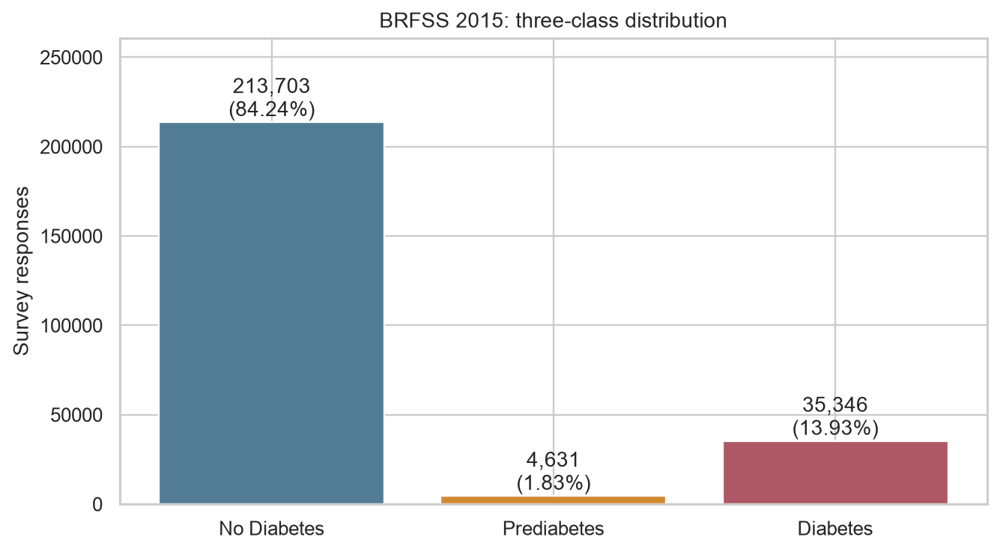
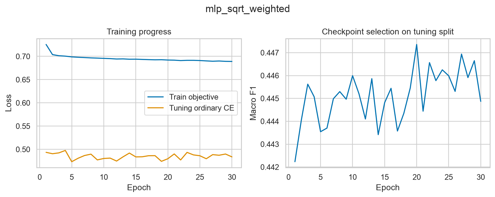
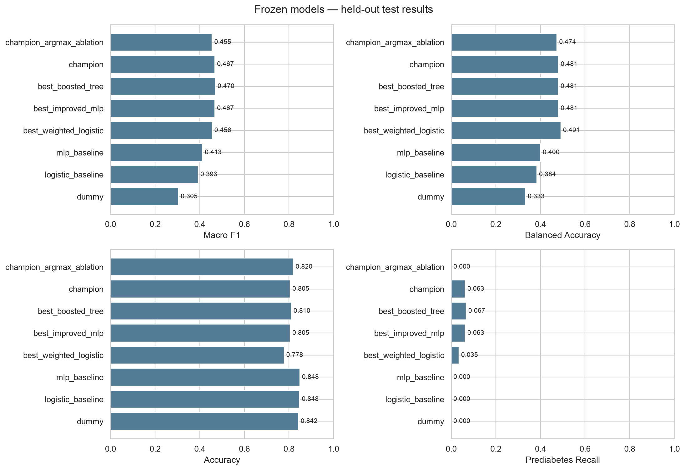
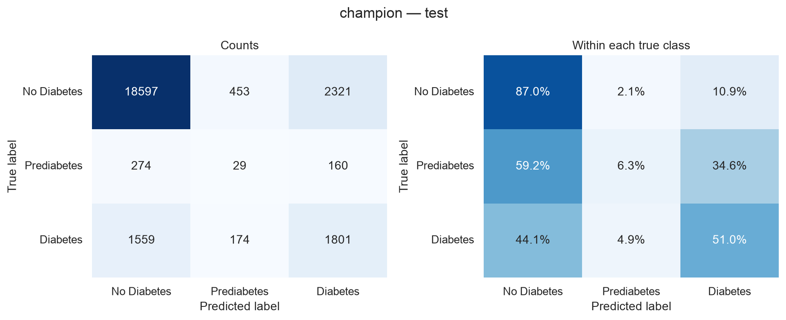
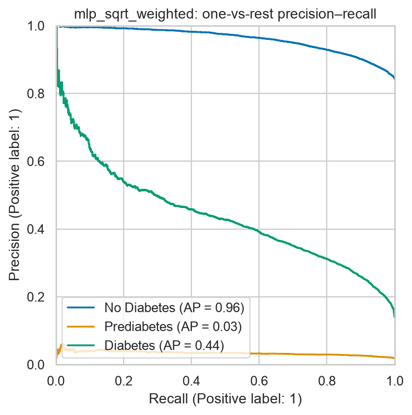

# Diabetes ML — experiment report

Completed 28 October 2026. The validation-selected model improved held-out test macro F1 from **0.4128 to 0.4675**: **+0.0547 absolute**, or **13.2% relative**. Diabetes recall increased from **23.3% to 51.0%**. Accuracy decreased from **84.8% to 80.5%**. These are paired comparisons on the same test rows.

**Prediabetes remains poorly identified:** recall 6.3%, precision 4.4%. The model identifies only 29 of 463 prediabetes responses, and only 29 of 656 predictions of prediabetes are correct. The improvement primarily reflects better diabetes detection; this experiment does not solve prediabetes screening.

## Research question

How do imbalance-aware training and class-specific decision rules affect diabetes status classification from health and lifestyle survey indicators? This study compares logistic regression, multilayer perceptrons, gradient-boosted trees and soft-voting ensembles using identical training, validation and test partitions. Macro F1 is the primary model-selection metric, with class-level precision and recall used to assess minority-class performance.

## Data and safeguards

- Source: [Alex Teboul's Diabetes Health Indicators Dataset](https://www.kaggle.com/datasets/alexteboul/diabetes-health-indicators-dataset), three-class BRFSS 2015 file.
- 253,680 responses, 21 predictors, zero missing cells. Class counts: no diabetes 213,703; prediabetes 4,631; diabetes 35,346.
- Stratified seed-42 split: training 202,944; validation tuning 12,684; validation selection 12,684; test 25,368. Scaling and class weights come from training only.
- Fit checkpoints, boosting iterations, decision offsets and ensemble membership use tuning. Final candidate ranking uses selection macro F1. The timestamped manifest was saved before test evaluation.
- 18 fitted models/blends and 36 model/decision candidates. All models, histories, configurations and source checksums are saved.
- Preserve the original rows: 23,899 duplicate full rows after the first and 25,772 duplicate feature profiles. Survey answers can coincide for different people; no person IDs are available.

Source CSV SHA-256: `a971809d0786d2d7d7f6070f83dfe8af9d860ea33a79e0e2701c8a49f78f9861`.

## Selected model and evaluated techniques

The selected model is **mlp_sqrt_weighted**, a ReLU network with hidden widths [64, 32]. It uses square-root inverse-frequency class weighting, dropout 0.1, AdamW learning rate 0.001, weight decay 0.0001, batch size 256, and 30 training epochs. The best checkpoint was epoch **20**, selected on tuning macro F1.

The saved decision rule adds offsets `[0.0, 1.0, 0.0]` to log raw scores and takes argmax. This gives prediabetes a greater chance of being selected without changing the underlying ranking scores. Raw scores are not calibrated probabilities. Class weights actually used: `[0.7639, 5.1893, 1.8784]`.

We also tested focal loss (gamma 2), fully balanced neural loss, histogram gradient boosting, CatBoost depth/weight variants, and tree/neural soft-voting ensembles. Greater model complexity did not consistently yield better selection scores. The validation-selected weighted MLP remained the final model.

### Selection ranking (before opening the test results)

| model | decision | macro_f1 | balanced_accuracy | prediabetes_recall |
| --- | --- | --- | --- | --- |
| mlp_sqrt_weighted | tuned | 0.4728 | 0.4869 | 0.0779 |
| catboost_depth6_weight0.5 | tuned | 0.4703 | 0.4817 | 0.0823 |
| ensemble_trees | tuned | 0.4690 | 0.4819 | 0.0649 |
| hist_gradient_weight0 | tuned | 0.4675 | 0.4889 | 0.1039 |
| catboost_depth7_weight0.5 | tuned | 0.4674 | 0.4977 | 0.1082 |
| ensemble_trees_mlp | tuned | 0.4669 | 0.4940 | 0.1126 |
| catboost_depth5_weight0 | tuned | 0.4668 | 0.4807 | 0.0563 |
| hist_gradient_weight0.5 | tuned | 0.4653 | 0.4765 | 0.0736 |
| mlp_baseline | tuned | 0.4635 | 0.4856 | 0.0866 |
| catboost_depth6_weight1 | tuned | 0.4604 | 0.4921 | 0.0909 |

Selection macro F1 for the champion was **0.4728**. The boosting finalist achieved a slightly higher test macro F1 (0.4699) than the chosen model; the model was **not replaced after test inspection**.

## Held-out test results

| model | accuracy | balanced_accuracy | macro_f1 | prediabetes_recall | diabetes_recall |
| --- | --- | --- | --- | --- | --- |
| dummy | 0.8424 | 0.3333 | 0.3048 | 0.0000 | 0.0000 |
| logistic_baseline | 0.8475 | 0.3838 | 0.3930 | 0.0000 | 0.1740 |
| mlp_baseline | 0.8482 | 0.4003 | 0.4128 | 0.0000 | 0.2326 |
| best_weighted_logistic | 0.7779 | 0.4912 | 0.4556 | 0.0346 | 0.6188 |
| best_boosted_tree | 0.8102 | 0.4806 | 0.4699 | 0.0670 | 0.4966 |
| champion | 0.8052 | 0.4808 | 0.4675 | 0.0626 | 0.5096 |

`best_improved_mlp` and `champion` refer to the same selected model, so the duplicate is omitted from this table. The full CSV retains all pre-frozen comparisons.

### Per-class results for the selected model

| class | precision | recall | specificity | f1 | support | average_precision |
| --- | --- | --- | --- | --- | --- | --- |
| No Diabetes | 0.9103 | 0.8702 | 0.5414 | 0.8898 | 21371 | 0.9606 |
| Prediabetes | 0.0442 | 0.0626 | 0.9748 | 0.0518 | 463 | 0.0339 |
| Diabetes | 0.4206 | 0.5096 | 0.8864 | 0.4608 | 3534 | 0.4376 |

Specificity is one-versus-rest. Average precision uses raw one-versus-rest ranking scores. Precision and recall use the final decision rule. Class-1 average precision is low, consistent with the difficult prediabetes distinction.

### Where the improvement comes from

| model | accuracy | macro_f1 | balanced_accuracy | prediabetes_recall | diabetes_recall |
| --- | --- | --- | --- | --- | --- |
| mlp_baseline | 0.8482 | 0.4128 | 0.4003 | 0.0000 | 0.2326 |
| champion | 0.8052 | 0.4675 | 0.4808 | 0.0626 | 0.5096 |
| champion_argmax_ablation | 0.8197 | 0.4552 | 0.4739 | 0.0000 | 0.5376 |

Weighted training/regularization raises macro F1 even before decision tuning. Decision tuning then adds minority-class predictions and improves macro F1 further. This is an empirical comparison: architecture regularization and class weights were changed together, so the experiment does not isolate each training ingredient causally.

### Uncertainty

The paired stratified bootstrap (2,000 resamples) gives a **95% interval of [0.0467, 0.0630]** for macro-F1 improvement over our MLP baseline. The champion macro-F1 interval is [0.4597, 0.4754].

These intervals condition on one partition and trained models. They do not include retraining variation, model selection uncertainty, profile clustering or survey-design effects.

### Duplicate-profile sensitivity

| model | subset | rows | accuracy | macro_f1 | prediabetes_recall | diabetes_recall |
| --- | --- | --- | --- | --- | --- | --- |
| mlp_baseline | profile_seen_in_training | 3480 | 0.9451 | 0.3357 | 0.0000 | 0.0183 |
| mlp_baseline | profile_unseen_in_training | 21888 | 0.8327 | 0.4128 | 0.0000 | 0.2430 |
| champion | profile_seen_in_training | 3480 | 0.9382 | 0.3924 | 0.0000 | 0.1524 |
| champion | profile_unseen_in_training | 21888 | 0.7841 | 0.4656 | 0.0667 | 0.5270 |

The champion's macro-F1 improvement also appears among the 21,888 test rows with feature profiles absent from training. This is a descriptive subset check; it is not a separate group-held-out study. Repeated profiles have different class composition, so compare models within each subset.

## Remaining limits and follow-up research

Prediabetes sensitivity and precision remain low. Fully balanced models showed higher minority recall on selection but lower macro F1/accuracy; see the experiment CSV before choosing a different operating objective. No further tuning was performed after test results were available. A future recall-constrained experiment should use a new evaluation protocol or nested cross-validation, rather than repeatedly optimizing this test set.

This is cross-sectional status classification using self-reported 2015 US survey responses, not prediction of future onset. Model associations do not establish causes. No survey weights, prospective validation, subgroup fairness study or clinical calibration were performed. The results support a research analysis of this dataset; clinical use requires further validation.

## Project files

- `../README.md`: setup and runnable commands.
- `../METHODOLOGY.md`: full experiment specification and technical references.
- `../DATA_DICTIONARY.md`: feature meanings and valid survey codes.
- `../notebooks/01_exploration_and_results.ipynb`: executed exploration and results notebook.
- `experiment_results.csv`: tuning/selection outcomes for all candidates.
- `test_results.csv`: frozen held-out comparisons.
- `../models/selection_manifest.json`: selection timestamp, exact model and decision rule.
- `histories/`, `figures/`, `training.log`: training evidence and presentation artifacts.
